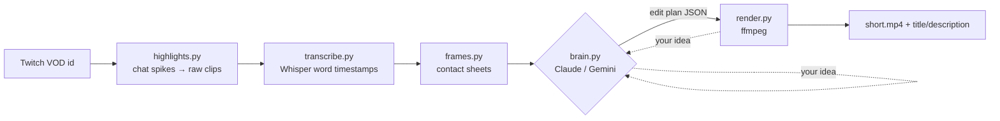

# Twitch → Shorts Pipeline

Turn a Twitch VOD into ready-to-upload vertical YouTube Shorts with one command.
It finds the moments where chat went wild, lets an AI "brain" (Claude or Gemini) watch them
and write an edit plan, then renders a 1080×1920 Short with ffmpeg — hook text, word-by-word
captions, camera/gameplay layouts, zooms, stickers, sound effects and an on-screen chat box.

You stay in the loop: every plan and every finished video can be approved, skipped or
re-edited by typing your own idea in plain language.



## Features

- **Hype detection from chat** – weighted chat activity (KEKW, LUL, WHAT, 😂…) against a local
  baseline, so it finds real spikes, not just busy hours.
- **Two brains, automatic fallback** – Claude Code (Claude Pro/Max login) and Gemini CLI
  (Google login). In `auto` mode, if one hits its usage limit the other takes over.
- **Layouts & scenes** – camera on top / gameplay below, full camera, full gameplay, blurred
  background; the brain can switch layout, enlarge the camera or zoom into the action mid-clip.
- **Captions** – 2 words at a time, active word highlighted, emphasis words bigger.
- **Hook, stickers, image overlays** – AI-written hook text, pop-in text stickers, and your own
  images from `assets/` placed at the right second.
- **Sound-effect library** – 15 royalty-free synthetic effects (whoosh, vine-style boom, ding,
  riser, record scratch…) plus any you add.
- **On-screen Twitch chat** – a chat box appears for 3–4 s when chat laughs.
- **Your ideas everywhere** – standing rules file, per-run idea, and an interactive review
  after each plan and each render.

## Quick start (Windows)

1. Clone or download this repository (keep it in a folder **without** special characters if
   possible, e.g. `C:\shorts`).
2. Double-click **`setup.bat`** – installs the Python packages, TwitchDownloader and FFmpeg.
3. Install at least one brain and log in once:
   ```powershell
   irm https://claude.ai/install.ps1 | iex      # Claude Code, then run: claude
   npm install -g @google/gemini-cli             # Gemini CLI, then run: gemini
   ```
4. Double-click **`run.bat`** and paste a VOD id (the number in `twitch.tv/videos/<id>`).

Finished Shorts land in `shorts/<date>/<streamer>_<vod>_<nn>/`.

📖 **Full manual: [docs/USER_GUIDE.md](docs/USER_GUIDE.md)**

## Requirements

- Windows 10/11, Python 3.10–3.13
- An NVIDIA GPU is optional (speeds up transcription)
- A Claude Pro/Max account (for Claude Code) and/or a Google account (for Gemini CLI)

## Credits & licenses

This project's code is MIT-licensed (see [LICENSE](LICENSE)). It uses:

- [TwitchDownloader](https://github.com/lay295/TwitchDownloader) (MIT) – downloaded by `setup.bat`
- [FFmpeg](https://ffmpeg.org) (GPL build by [BtbN](https://github.com/BtbN/FFmpeg-Builds)) – downloaded by `setup.bat`
- [faster-whisper](https://github.com/SYSTRAN/faster-whisper) (MIT)
- [Montserrat](https://github.com/JulietaUla/Montserrat) font (SIL OFL 1.1) – bundled in `tools/fonts`
- Sound effects in `sfx/` are generated by `tools/make_sfx.py` and are free to use.

**Content note:** the clips you make contain other creators' streams. Respect their wishes,
add real transformation (commentary, editing), and read YouTube's reused-content policy before
monetizing.
